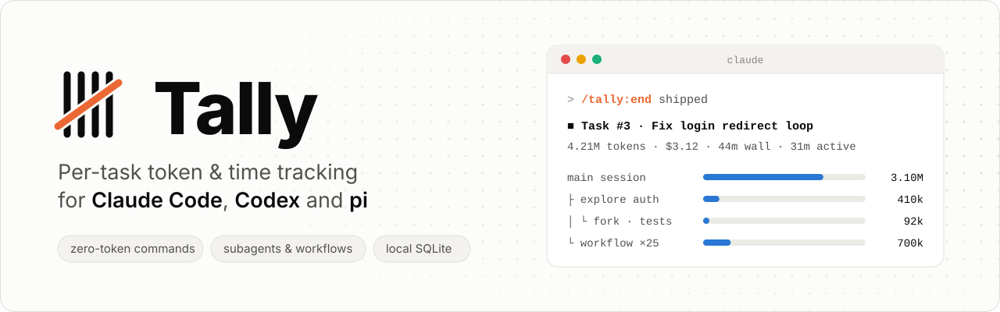

<p align="center">
  <picture>
    <source media="(prefers-color-scheme: dark)" srcset="docs/assets/banner-dark.svg">
    <source media="(prefers-color-scheme: light)" srcset="docs/assets/banner-light.svg">
    
  </picture>
</p>

# Tally

**Per-task token and time tracking for Claude Code, Codex and pi.** It runs locally with zero dependencies, stores everything in SQLite, and its commands cost no tokens.

You start a task inside Claude Code, Codex or pi and keep working. While it is open, Tally counts:

- the main conversation;
- every subagent, including background agents and nested forks;
- every workflow agent, grouped by run and phase.

When you end it, you get totals plus subtotals per agent, subagent, workflow, agent type and model. You also get wall time and active time, and the task name and initial prompt are stored.

```
/tally:start Fix login redirect loop
… work as usual …
/tally:end
```

```
▍Tally · ■ Task #3 ended: Fix login redirect loop
  prompt   The login page loops back to /login after OAuth callback, find out why and fix it
  time     44m 10s wall · 31m 02s active (12 turns) · 2026-10-12 14:03 → 14:47
  tokens   4.21M total · in 12.3k · out 85.1k · cache write 410.2k · cache read 3.70M
  cost     ≈ $3.12 at list price · 171 API calls
  models   opus-5-5 3.90M $2.80 · sonnet-5-5 310.0k $0.32

  breakdown                                        tokens   output      cost      time  calls
  main session (own)                                3.10M    60.2k     $2.10   31m 02s     42
  ├─ general-purpose · Explore auth flow            410.0k     8.1k    $0.300    1m 10s      9
  │  └─ fork · Write regression test                 92.0k     2.0k    $0.071       48s      3
  └─ workflow · review-changes (25 agents)          700.0k    16.0k    $0.720    6m 30s    120
     ├─ phase · Review (20)                         560.0k    12.1k    $0.580    4m 10s     96
     └─ phase · Verify (5)                          140.0k     3.9k    $0.140    2m 20s     24
  TOTAL                                             4.21M    85.1k     $3.12   44m 10s    171
```

## Features

- **Zero-token commands.** `/tally:*` is answered inside a hook, so the model is never called.
- **Everything is attributed.** The main agent, subagents, nested forks, background agents, and workflow runs with their phases and agents, as a tree with subtotals.
- **Per-prompt statistics.** Tokens, cost, time, subagents and tool calls for every prompt. Attribution is exact, because each API call is linked to the prompt that caused it.
- **Todo list.** Quick capture with `@project`, priority and due date. `/tally:take` and `/tally:do` pick a todo up and measure what it costs, and reminders appear at session start. Plans from superpowers and similar tools are imported, and a skill lets Claude keep the board current.
- **Projects.** The first time you open a repository, Tally asks whether to track it. You then get overall statistics per project (7 and 30 days, a daily series, models, tasks, todos).
- **Accurate.** Tokens come from Claude Code's own transcripts. Its internal calls that never reach a transcript are reconciled from its session cost record. The result matches Claude Code's own cost to within 2% on 40 of 40 validated sessions.
- **Easy to keep current.** One line installs it; `tally update` updates it, and Tally says when a new version is out.
- **Your choice of detail.** `log.depth` is `summary`, `prompts` or `calls`. `log.prompts` is `full`, `preview` or `off`, for privacy. The first install asks about these in a short setup; `tally setup` asks again.
- **Robust and fast.** It survives `/clear`, multiple sessions and parallel terminals, and takes about 33 ms per hook. Reports are frozen when a task ends.
- **All sessions at a glance.** `/tally:sessions`, `tally sessions` and the dashboard's Sessions tab list the sessions of every agent, with or without a task: agent, project, time, prompts, tokens, cost and models. It reads the agents' own transcripts into a separate index, so it also covers history from before Tally was installed. Only the projects you choose are read (set to `track` or `tasks`), plus single sessions you add in the dashboard; the rest is counted and offered there. `sessions.scope all` reads everything.
- **Dashboard.** A local dashboard with tasks, a todo board, projects, sessions and settings, in light and dark. Rename, end or delete tasks and edit todos right there. There is also a status line segment and a CLI.
- **Export and copy.** A time sheet of your tasks (CSV with h:mm and decimal hours), one line per task for your time tracker, Markdown reports of a task, project or session, and a summary of everything, from the dashboard or `tally export`.
- **Three agents, one ledger.** Claude Code, Codex and pi feed the same database: the same tasks, todos, projects and reports, whichever agent did the work.

## Install

You need `python3` 3.8 or newer and `git`; on macOS both come with the Command Line Tools (`xcode-select --install`). And Claude Code 2.1+, Codex or pi. There are no packages to install.

```bash
curl -fsSL https://raw.githubusercontent.com/janhorecny/tally/main/install.sh | bash
```

The installer downloads Tally to `~/.local/share/tally`, detects **Claude Code, Codex and pi**, asks which ones to install into, and links the CLI as `~/.local/bin/tally`. The first time, it also asks a few setup questions; Enter keeps the default:

```
▍Tally · Setup · Enter keeps the value in [brackets]
  Store prompt text?          full / preview / off       [full]
  Logging detail?             summary / prompts / calls  [prompts]
  New projects:               ask / track / tasks        [ask]
  Sessions overview reads:    enabled / all              [enabled]
  Start a task automatically with each session? y/N
  Show open todos at session start? Y/n
  Tell me when a new version is out? Y/n
  Add Tally to Claude Code's status line? Y/n
```

`tally setup` asks them again at any time. To skip all questions, add `-s -- --yes` after `bash` (every detected agent, default settings), or `-s -- --agents claude,pi`. Then:

| agent | what gets installed | after installing |
|---|---|---|
| Claude Code | plugin `tally@tally` (local marketplace from this folder) | restart, or run `/reload-plugins` |
| Codex | hooks merged into `~/.codex/hooks.json`, skill in `~/.agents/skills` | approve the hooks once in Codex: `/hooks` |
| pi | extension `~/.pi/agent/extensions/tally.ts`, skill | restart pi, or run `/reload` |

The first session in each newly installed agent shows a short welcome. `tally doctor` shows what is installed where.

**Other ways in:**

- **Claude Code only, from its plugin manager:** `/plugin marketplace add janhorecny/tally`, then `/plugin install tally@tally`. Codex, pi, the `tally` command and the setup questions need the installer above.
- **From a clone, to work on the code:** `git clone https://github.com/janhorecny/tally.git && cd tally && ./install.sh`. Claude Code then installs from that folder, and `tally update` updates it.

**Uninstall:** `~/.local/share/tally/uninstall.sh` (or `./uninstall.sh` in a clone) removes Tally from every agent and keeps your history; `--agents codex` removes it from one agent only, `--purge` deletes the history too.

## Updating

```bash
tally update
```

It pulls the latest version, installs it into every agent Tally is in, restarts a running dashboard and lists what changed. Then run `/reload-plugins` in Claude Code (or restart it), `/reload` in pi, and restart Codex.

**You hear about new versions** at most once a day: in the session start message of your agents, below CLI commands on a terminal, and as a ⬆ chip next to the version in the dashboard (a click copies `tally update`). To know, Tally asks GitHub for the latest release once a day, in the background. Nothing about you or your usage is sent. `tally update --check` checks right now; `tally settings updates.check off` turns the check off.

Installed from Claude Code's plugin manager: `claude plugin marketplace update tally && claude plugin update tally@tally`. Release notes: [CHANGELOG](CHANGELOG.md) and [GitHub releases](https://github.com/janhorecny/tally/releases).

## Commands

Shown in Claude Code syntax. In **Codex** type `tally:start …` as a prompt; in **pi** use `/tally start …`. Every command with its arguments and examples: [command reference](docs/commands.md).

| tasks | |
|---|---|
| `/tally:start [name]` | Start a task in this session. The next prompt is stored as its initial prompt. |
| `/tally:new <prompt>` | Start a task and send `<prompt>` to Claude. |
| `/tally:status [id]` · `/tally:stats [id]` | Live totals · detailed statistics (per prompt, tools, averages). |
| `/tally:end [id] [note]` | End the task and show the final report. |
| `/tally:list` · `/tally:show [id]` · `/tally:resume <id>` · `/tally:rename [id] <name>` | History, any report, continue elsewhere, rename. |

| todos | |
|---|---|
| `/tally:todo <text>` | Add one: `@project`, `!`/`!!`/`!!!`, `due:fri\|zajtra\|+3d\|20.10.`, ` -- notes`. |
| `/tally:todos [project\|all\|done]` | Open todos of this project. |
| `/tally:take <id>` · `/tally:do <id>` | Pick up (measuring starts) · pick up and let Claude work on it. |
| `/tally:done [id]` · `/tally:mark <id> <status>` | Finish it (ends its task) · `todo`, `doing`, `blocked`, `done` or `dropped`. |

| projects and more | |
|---|---|
| `/tally:project [name] [track\|tasks\|off]` · `/tally:projects` | Overall statistics of this project, or set its mode · all projects. |
| `/tally:sessions [days\|all] [agent] [here]` | Every session of every agent with tokens, cost, models and time (default: 7 days). |
| `/tally:settings [key value]` | `log.depth`, `log.prompts`, `sessions.scope`, `updates.check`, `auto_start` … |
| `/tally:dashboard [stop]` · `/tally:help` | Local dashboard (http://127.0.0.1:8765), or stop it · help. |

The CLI has the same features: `tally list | status | stats | show | todo … | project | projects | sessions | session <id> | settings | setup | export | dashboard | statusline | update | doctor`. `tally` alone shows the most used ones. See the [CLI reference](docs/cli.md).

## Documentation

| | |
|---|---|
| [Usage guide](docs/usage.md) | Scenarios, todos, projects, sessions, detailed stats, settings, agents, reading the report, dashboard, status line, recipes. |
| [Command reference](docs/commands.md) | Every `/tally:*` command: syntax, arguments, examples. |
| [CLI reference](docs/cli.md) | Every `tally` command and option. |
| [How it works](docs/how-it-works.md) | Architecture, hooks, transcript ingest, attribution, time, cost, reconciliation, performance, security. |
| [Configuration](docs/configuration.md) | `config.json`, auto-start, pricing overrides, environment variables. |
| [Data model](docs/data-model.md) | SQLite schema and example queries. |
| [Troubleshooting](docs/troubleshooting.md) | `tally doctor`, common questions, uninstall. |
| [Roadmap](docs/roadmap.md) | Ideas and planned improvements. |
| [Changelog](CHANGELOG.md) | Release history. |

## Development

```bash
scripts/check.sh                               # 78 end-to-end tests, lint, byte-compile, manifests, doc links (~15 s)
scripts/check.sh --all                         # also Python 3.8, 3.11, 3.13 (uv) and Linux (Docker), ~1 min
git config core.hooksPath .githooks            # run scripts/check.sh before every push
python3 scripts/validate_against_claude.py     # compare with Claude Code's own totals (reads files only)
claude --plugin-dir ./plugin                   # try the plugin without installing it
python3 scripts/make_banner.py                 # regenerate docs/assets/banner-{light,dark}.svg
scripts/release.sh                             # publish the version in __init__.py: checks, push, tag, GitHub release
```

**Releasing:** bump the version in `plugin/tally/__init__.py`, `plugin/.claude-plugin/plugin.json` and `.claude-plugin/marketplace.json`, add its section on top of `CHANGELOG.md`, commit, then `scripts/release.sh`. Installed copies hear about the new release within a day, and `tally update` pulls `main`, so push only finished versions there.

Checks run locally. The GitHub Actions workflow is disabled and only runs when started by hand, on Linux, because macOS runners are billed at ten times the minutes.

Layout:

- `plugin/`: the Claude Code plugin (manifest, hooks, commands, `bin/tally`, and the `tally` Python package);
- `tests/`;
- `scripts/`;
- `docs/`.

## License

[MIT](LICENSE)
